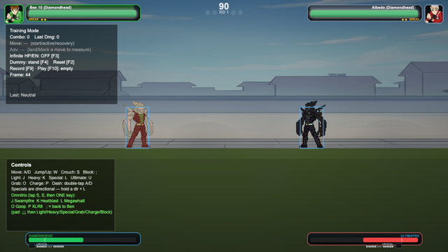
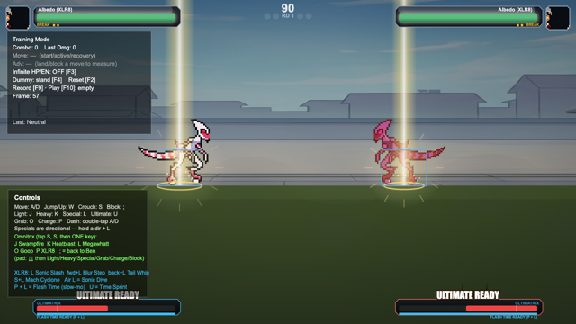
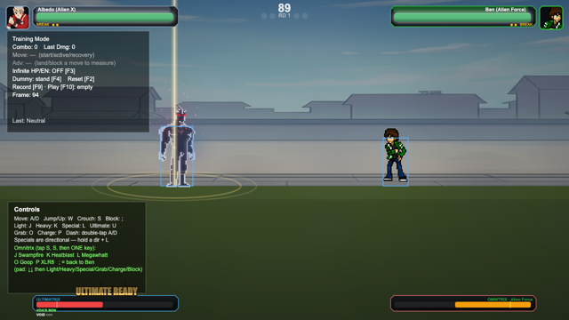
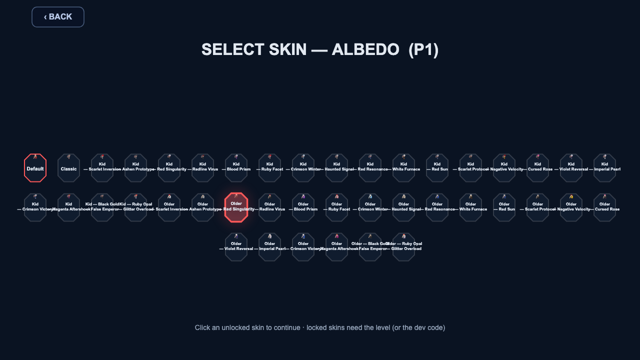

# Albedo skin themes — verification report (2026-11-19)

Branch `feat/albedo-skin-themes` (clean clone `multiverse-smash-albedo-skins`, base origin/main `894d16a8b`).
- **Input:** all browser checks drive the real game headless (Playwright Chromium) with SIMULATED keyboard / mouse input.
  No physical DualSense was connected for any check; the pad buttons are documented from `input.js` (`PS5_MAP`,
  `pollMenuGamepad`), not exercised.
- **Host:** the machine was heavily loaded by another app during the runs, which is why the long browser run was split into
  slices.

## Tests
| suite | result | baseline (origin/main export) |
|---|---|---|
| `harness/albedo_themes.test.mjs` (new) | **55 / 0** | — |
| `harness/albedo_themes_render.mjs` section 1, 8 slices × 5 themes | **all pass**: 40/40 combos, **960/960** theme × form transforms themed, revert restores, HP / variant correct, Ben on original art | — |
| `harness/albedo_themes_render.mjs --only-extras` | **31 / 1** (one pacing measurement, see below) | — |
| `determinism.test.mjs` | 14 / 0 | 14 / 0 |
| `combo_standard_audit.mjs` | 233 / 9 | 233 / 9: the identical 9 |
| `roster_integrity.test.mjs` | verified | verified |
| `albedo_mirror.test.mjs` | 80 / 1 | 80 / 1: the same pre-existing lint hit `ben10VoiceMap.js:51` (VO commit) |
| `albedo.test.mjs` | 11 / 0 | — |
| `ben10_vow_determinism.test.mjs` | 7 / 0 | — |

## Frame-data diff (cosmetic-only proof)
`tools/albedo/framedata_dump.mjs` was run on this branch and on a `git archive origin/main` export, then the dumps were
compared:
- **Characters:** all 157 identical: stats, normals, specials, ultimates, transformations, frame data, animation geometry and
  sheets.
- **Ben / Albedo variant stats:** identical.
- **Form tables:** all 312 Ben/Albedo × variant × alien tables identical, including stats, normals, specials, geometry and
  sheets.
- **Skin lists:** every list identical except **albedo**: 38 entries added, and `albedoAlienX` / `albedoValkyrie` changed
  from missing sheets to working themes.

Themed vs default Albedo play the same frame by frame (`albedo_themes.test.mjs` B: damage, health, movement, jumps, boxes,
form state, costs, timers, Vow, revert), for every theme id across all 24 forms.

## Bidirectional Ben / Albedo isolation: PASS
- **No Albedo theme can reach Ben.** For every theme id × rosterKey ben10 / other, the theme resolver returns null. Ben's
  skin ids pass through `albedoBaseSkinId` unchanged.
- **Ben's skins, art and data are untouched.** Ben's skin list, variant stats and every form table are byte-identical to
  origin/main; no theme module names a Ben sheet; cache keys are `albedo|…`.
- **In the same match (real game):**
  - Albedo with a theme plus Ben with his `default` / `ben10Classic` / `ben10_crimson` skins, both transformed into
    Diamondhead: Ben draws `ben10_diamondhead_idle_uniform.png` (original); Albedo draws his Redline Virus canvas.
  - Two Albedos (kid Ruby Opal vs older Blood Prism), both XLR8: each keeps its own theme.
- **Cache reuse between matches, rematch and restart:**
  - A fresh match restores the appearance + theme.
  - A skin chosen by a real click on the select screen survives a page reload (session save).
  - A Ben pick never enters the Albedo cache.
- **Projectiles / effects:** FX sheets are not recolored for anyone, so their palette is identical whoever fires and nothing
  leaks between owners.

## Frame pacing (headless, software rendering ≈ 30 fps on this machine)
Each check measures 150 rAF intervals in the same scene with Albedo's unthemed default, then with the theme.

| scene | themed p95 | unthemed baseline p95 |
|---|---|---|
| First transform into Jetray (largest form, generation running) | 49.3 ms | 49.6 ms |
| Red Singularity Alien X (stars) | 33.7 | 34.3 |
| Ruby Opal Diamondhead vs Ben | 34.3 | 49.9 |
| Ruby Opal kid (glitter) | 33.8 / 34.1 / **50.0** | 49.4 / 34.0 / 33.6 |

- **Ruby Opal kid:** across three runs it failed once (one dropped frame) and passed twice. In other runs the unthemed
  baselines themselves spiked to 50–134 ms. Steady-state cost is the same by construction: a themed sheet is a cached canvas
  drawn exactly like the original image, and stars / glints are baked into it.
- **Generation:** at most 4 ms per frame (queued). The largest single sheet took 11–25 ms to generate in the browser.
  **Recorded limitation:** a single sheet larger than the 4 ms budget still costs its full generation time in one frame.

## Checklist (simulated input)
| check | result |
|---|---|
| boot → pick Albedo → kid or older + theme (all 40) → match → both fighters + HUD render | ✅ |
| transform (forced into every form; real dial ↓↓+L) / revert | ✅ |
| ultimate form + return | ✅ |
| round end / rematch | ✅ |
| restart restores the saved selection | ✅ |
| two Albedos, different appearance + theme | ✅ |
| Albedo vs Ben, shared alien form | ✅ |
| player-colour tint / hurt flash | sprite.js draws its tint / flash canvases from whatever sheet it was handed (the themed canvas), so they apply unchanged; not separately pixel-asserted |
| brightest / darkest stage | contact sheets show every form on a bright and a dark background (`img/*_themes.png`); in-game only the default training stage was used |
| physical DualSense | not tested (no controller attached) |

Evidence (in-game):  
 

## Animation coverage / genuine missing art
Per form: `<form>_REGIONS.md` → "Animation coverage". For both appearances and all 24 forms, idle / walk / light / heavy /
hurt / knockdown each have their own art, and all of it is themed. Remaining gaps are regional, not missing frames (older
jacket trim shares white with the eyes / soles; kid shoes share black / white with the outline; Highbreed has no Ultimatrix
mark). They are recorded in `docs/skins/albedo/README.md`; no frames or regions were invented.
