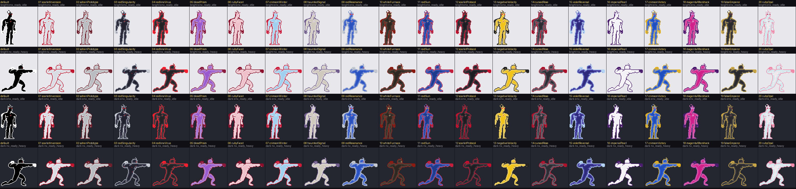

# Alien X — Albedo theme regions

Albedo-only. Source: Albedo's own `__albedo` sheets (32 strips, base + alternate tables). Rules are first-match; unmatched pixels are kept. Each matched pixel takes its role's theme colour, ramped by its own brightness ÷ the rule's reference brightness (vref). Alpha is never changed.

Dark / cosmic form: flat-black source → base colour + a graded 3px inner rim (limb separation); stars only on Red Singularity, interior pixels only.

| # | region | role | match | vref | pixels (all strips) |
|---|---|---|---|---|---|
| 0 | chest mark (Ultimatrix red) | energy | h 356–4, s 0.74–0.86, v 0.04–1 | 0.902 | 495 |
| 1 | white starfield / outline | accent | s 0–0.3, v 0.7–1 | 1 | 24160 |
| 2 | void body (flat black source → base colour + inner rim) | primary | s 0–0.3, v 0–0.7, inner rim, flat | 0 | 48371 |

## Animation coverage (themed wherever the art exists)

| action | art |
|---|---|
| idle | own art |
| walk | own art |
| light | own art |
| heavy | own art |
| hurt | own art |
| knockdown | own art |

