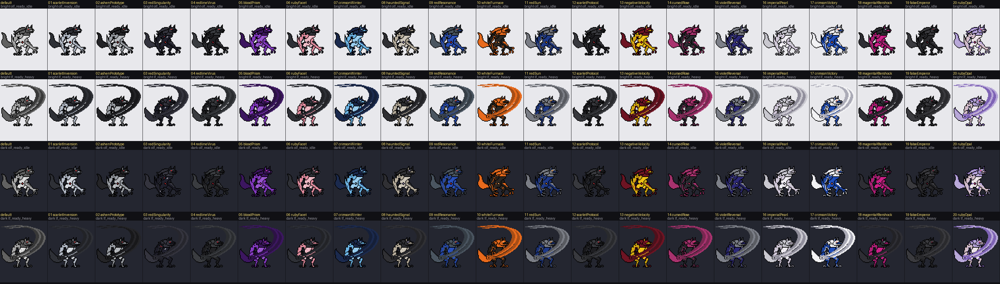

# Benwolf — Albedo theme regions

Albedo-only. Source: Albedo's own `__albedo` sheets (37 strips, base + alternate tables). Rules are first-match; unmatched pixels are kept. Each matched pixel takes its role's theme colour, ramped by its own brightness ÷ the rule's reference brightness (vref). Alpha is never changed.

Fur form: fur shades (primary / secondary) are separate from the Ultimatrix mark / eyes (energy).

| # | region | role | match | vref | pixels (all strips) |
|---|---|---|---|---|---|
| 0 | outline (kept) | keep | s 0–1, v 0–0.07 | 0 | 30469 |
| 1 | eyes + mark (Ultimatrix red) | energy | h 356–4, s 0.74–0.86, v 0.04–1 | 0.902 | 342 |
| 2 | dark fur | secondary | s 0–0.3, v 0.07–0.48 | 0.38 | 33165 |
| 3 | light fur | primary | s 0–0.3, v 0.48–1 | 0.878 | 19868 |

## Animation coverage (themed wherever the art exists)

| action | art |
|---|---|
| idle | own art |
| walk | own art |
| light | own art |
| heavy | own art |
| hurt | own art |
| knockdown | own art |

