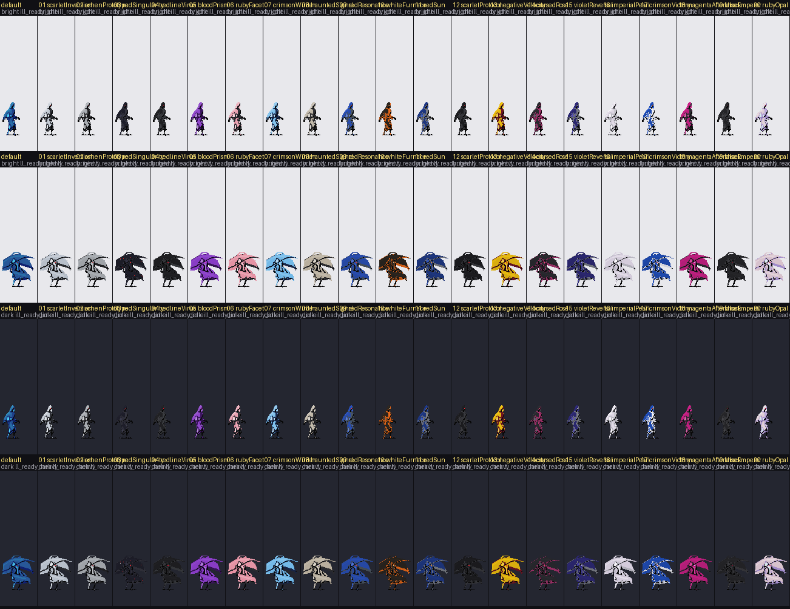

# Big Chill — Albedo theme regions

Albedo-only. Source: Albedo's own `__albedo` sheets (40 strips, base + alternate tables). Rules are first-match; unmatched pixels are kept. Each matched pixel takes its role's theme colour, ramped by its own brightness ÷ the rule's reference brightness (vref). Alpha is never changed.

Ice form: ice hide and dark hide / cloak are separate ramps.

| # | region | role | match | vref | pixels (all strips) |
|---|---|---|---|---|---|
| 0 | outline (kept) | keep | s 0–1, v 0–0.07 | 0.031 | 68915 |
| 1 | Ultimatrix mark | energy | h 356–4, s 0.74–0.86, v 0.04–1 | 0.596 | 446 |
| 2 | deep-blue cloak | secondary | h 218–260, s 0.2–1, v 0.07–1 | 0.533 | 115047 |
| 3 | ice-blue body | primary | h 170–217, s 0.2–1, v 0.07–1 | 0.753 | 267621 |

## Animation coverage (themed wherever the art exists)

| action | art |
|---|---|
| idle | own art |
| walk | own art |
| light | own art |
| heavy | own art |
| hurt | own art |
| knockdown | own art |

