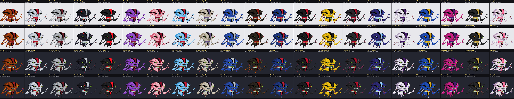

# Brainstorm — Albedo theme regions

Albedo-only. Source: Albedo's own `__albedo` sheets (35 strips, base + alternate tables). Rules are first-match; unmatched pixels are kept. Each matched pixel takes its role's theme colour, ramped by its own brightness ÷ the rule's reference brightness (vref). Alpha is never changed.

Carapace form.

| # | region | role | match | vref | pixels (all strips) |
|---|---|---|---|---|---|
| 0 | outline (kept) | keep | s 0–1, v 0–0.07 | 0.043 | 29488 |
| 1 | head stripes / collar / eyes (Ultimatrix red) | accent | h 356–4, s 0.74–0.86, v 0.04–1 | 0.62 | 36094 |
| 2 | yellow glands | energy | h 40–70, s 0.3–1, v 0.4–1 | 0.937 | 11027 |
| 3 | carapace | primary | h 5–40, s 0.25–1, v 0.07–1 | 0.678 | 224784 |
| 4 | purple membrane | secondary | h 250–330, s 0.2–1, v 0.07–1 | 0.561 | 24512 |

## Animation coverage (themed wherever the art exists)

| action | art |
|---|---|
| idle | own art |
| walk | own art |
| light | own art |
| heavy | own art |
| hurt | own art |
| knockdown | own art |

