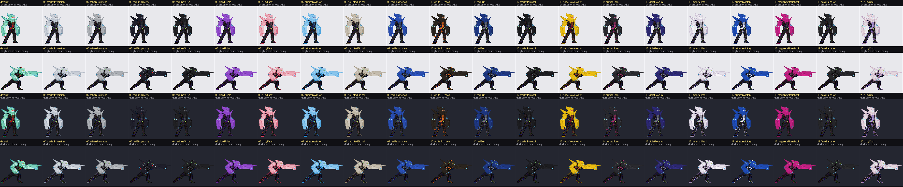

# Diamondhead — Albedo theme regions

Albedo-only. Source: Albedo's own `__albedo` sheets (64 strips, base + alternate tables). Rules are first-match; unmatched pixels are kept. Each matched pixel takes its role's theme colour, ramped by its own brightness ÷ the rule's reference brightness (vref). Alpha is never changed.

Crystal form: the facet ramp is the source brightness → bright-to-dark facets survive; pure-white facet highlights are kept.

| # | region | role | match | vref | pixels (all strips) |
|---|---|---|---|---|---|
| 0 | outline (kept) | keep | s 0–1, v 0–0.07 | 0.067 | 9371 |
| 1 | shirt panel + mark (Ultimatrix red) | secondary | h 356–4, s 0.74–0.86, v 0.04–1 | 0.671 | 11922 |
| 2 | shirt shading | secondary | h 340–15, s 0.3–1, v 0.07–1 | 0.22 | 2774 |
| 3 | crystal body (facet ramp kept) | primary | h 120–200, s 0.12–1, v 0.07–1 | 0.922 | 118331 |
| 4 | facet white highlights / dark pants | keep | s 0–0.12, v 0–1 | 0.957 | 15077 |

## Animation coverage (themed wherever the art exists)

| action | art |
|---|---|
| idle | own art |
| walk | own art |
| light | own art |
| heavy | own art |
| hurt | own art |
| knockdown | own art |

