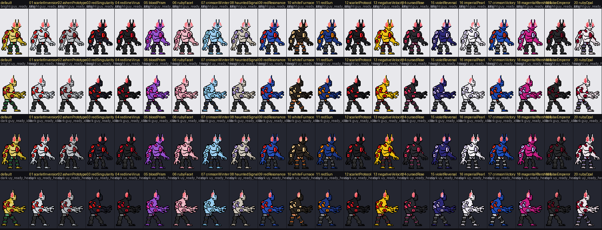

# Eyeguy — Albedo theme regions

Albedo-only. Source: Albedo's own `__albedo` sheets (34 strips, base + alternate tables). Rules are first-match; unmatched pixels are kept. Each matched pixel takes its role's theme colour, ramped by its own brightness ÷ the rule's reference brightness (vref). Alpha is never changed.

Organic form.

| # | region | role | match | vref | pixels (all strips) |
|---|---|---|---|---|---|
| 0 | outline (kept) | keep | s 0–1, v 0–0.07 | 0 | 28997 |
| 1 | eyes (Ultimatrix red) | energy | h 356–4, s 0.74–0.86, v 0.04–1 | 0.961 | 5721 |
| 2 | yellow hide | primary | h 30–75, s 0.25–1, v 0.2–1 | 0.89 | 27436 |
| 3 | shorts (dark green) | secondary | h 100–170, s 0.25–1, v 0.07–1 | 0.58 | 2500 |
| 4 | pink / red detail | accent | h 300–355, s 0.25–1, v 0.1–1 | 0 | 0 |

## Animation coverage (themed wherever the art exists)

| action | art |
|---|---|
| idle | own art |
| walk | own art |
| light | own art |
| heavy | own art |
| hurt | own art |
| knockdown | own art |

## Genuine gaps (recorded, not invented)

- Separate FX sheets (`*_fx_*`: beams, bursts, puffs) are not body strips and keep their colours — the same rule the original __albedo pass used, so they look the same for Ben and Albedo and never leak between owners.

