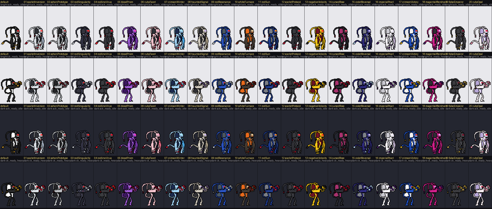

# Feedback — Albedo theme regions

Albedo-only. Source: Albedo's own `__albedo` sheets (33 strips, base + alternate tables). Rules are first-match; unmatched pixels are kept. Each matched pixel takes its role's theme colour, ramped by its own brightness ÷ the rule's reference brightness (vref). Alpha is never changed.

Energy form: electric / glow regions are energy; the body suit is secondary.

| # | region | role | match | vref | pixels (all strips) |
|---|---|---|---|---|---|
| 0 | outline (kept) | keep | s 0–1, v 0–0.07 | 0 | 26457 |
| 1 | eye / mark (Ultimatrix red) | energy | h 356–4, s 0.74–0.86, v 0.04–1 | 0.902 | 788 |
| 2 | cyan plug glow | energy | h 170–220, s 0.25–1, v 0.2–1 | 0.918 | 4836 |
| 3 | orange plugs | accent | h 15–50, s 0.25–1, v 0.2–1 | 0.749 | 1892 |
| 4 | black body | primary | s 0–0.25, v 0.07–0.5, inner rim | 0.157 | 26527 |
| 5 | white bands | secondary | s 0–0.25, v 0.5–1 | 1 | 12541 |

## Animation coverage (themed wherever the art exists)

| action | art |
|---|---|
| idle | own art |
| walk | own art |
| light | own art |
| heavy | own art |
| hurt | own art |
| knockdown | own art |

