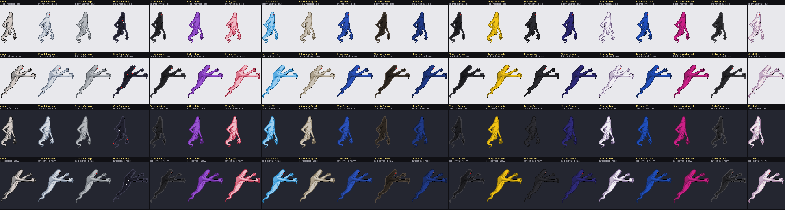

# Ghostfreak — Albedo theme regions

Albedo-only. Source: Albedo's own `__albedo` sheets (36 strips, base + alternate tables). Rules are first-match; unmatched pixels are kept. Each matched pixel takes its role's theme colour, ramped by its own brightness ÷ the rule's reference brightness (vref). Alpha is never changed.

Dark-bodied spectral form: the grey ramp is kept as the shading ramp (inner rim when the theme is dark); alpha untouched (fades / intangibility keep their curve).

| # | region | role | match | vref | pixels (all strips) |
|---|---|---|---|---|---|
| 0 | outline (kept) | keep | s 0–1, v 0–0.07 | 0 | 643 |
| 1 | eye / timeout flash (Ultimatrix red) | energy | h 356–4, s 0.74–0.86, v 0.04–1 | 1 | 6940 |
| 2 | teal tint | accent | h 140–200, s 0.15–1, v 0.07–1 | 0.125 | 39 |
| 3 | ghost skin (grey ramp) | primary | s 0–0.3, v 0.07–1, inner rim | 0.863 | 99883 |

## Animation coverage (themed wherever the art exists)

| action | art |
|---|---|
| idle | own art |
| walk | own art |
| light | own art |
| heavy | own art |
| hurt | own art |
| knockdown | own art |

