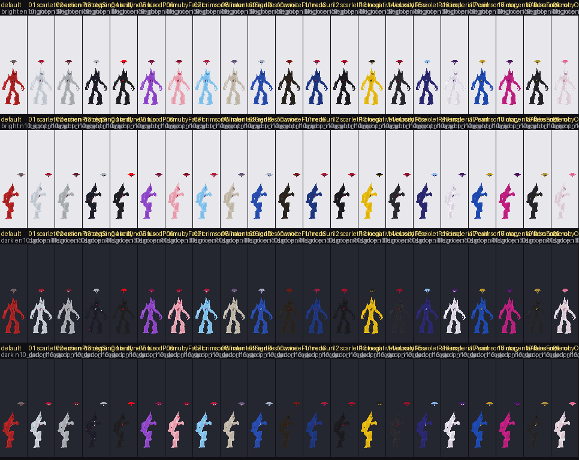

# Goop — Albedo theme regions

Albedo-only. Source: Albedo's own `__albedo` sheets (41 strips, base + alternate tables). Rules are first-match; unmatched pixels are kept. Each matched pixel takes its role's theme colour, ramped by its own brightness ÷ the rule's reference brightness (vref). Alpha is never changed.

Slime form: the goo body is primary; the projector is accent.

| # | region | role | match | vref | pixels (all strips) |
|---|---|---|---|---|---|
| 0 | outline (kept) | keep | s 0–1, v 0–0.07 | 0 | 0 |
| 1 | goo body (Ultimatrix red) | primary | h 356–4, s 0.74–0.86, v 0.04–1 | 0.784 | 341190 |
| 2 | goo shading | primary | h 330–20, s 0.25–1, v 0.07–1 | 0 | 0 |
| 3 | anti-gravity projector | accent | s 0–0.3, v 0.2–0.95 | 0.502 | 15428 |
| 4 | projector glow | energy | h 240–320, s 0.25–1, v 0.2–1 | 0 | 0 |

## Animation coverage (themed wherever the art exists)

| action | art |
|---|---|
| idle | own art |
| walk | own art |
| light | own art |
| heavy | own art |
| hurt | own art |
| knockdown | own art |

