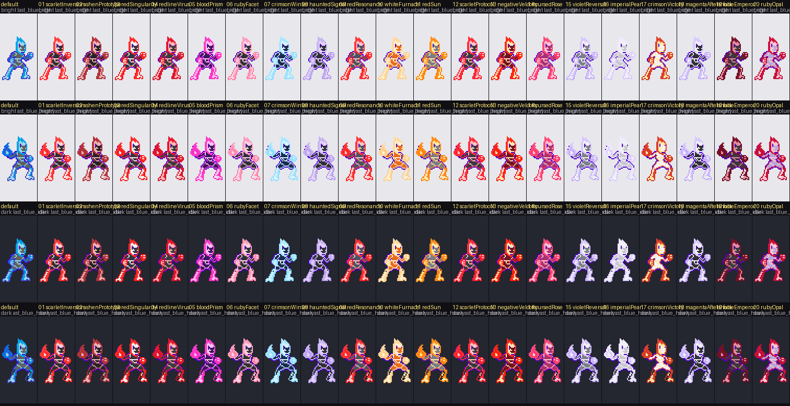

# Heatblast — Albedo theme regions

Albedo-only. Source: Albedo's own `__albedo` sheets (64 strips, base + alternate tables). Rules are first-match; unmatched pixels are kept. Each matched pixel takes its role's theme colour, ramped by its own brightness ÷ the rule's reference brightness (vref). Alpha is never changed.

Fire form: flame (energy) and white-hot core (core = energyCore) take different ramps from the rock body (primary).

| # | region | role | match | vref | pixels (all strips) |
|---|---|---|---|---|---|
| 0 | outline (kept) | keep | s 0–1, v 0–0.07 | 0 | 2998 |
| 1 | white-hot flame core | core | s 0–0.35, v 0.88–1 | 1 | 32940 |
| 2 | flame (yellow) + Ultimatrix mark | energy | h 35–75, s 0.25–1, v 0.3–1 | 1 | 23352 |
| 3 | Blue Flame table flame | energy | h 165–255, s 0.25–1, v 0.3–1 | 0.91 | 31395 |
| 4 | Ultimatrix mark | energy | h 356–4, s 0.74–0.86, v 0.04–1 | 0.902 | 182 |
| 5 | magma-rock body | primary | h 330–34, s 0.25–1, v 0.07–1 | 1 | 14559 |
| 6 | dark rock | secondary | s 0–0.25, v 0.07–0.62 | 0.38 | 18957 |

## Animation coverage (themed wherever the art exists)

| action | art |
|---|---|
| idle | own art |
| walk | own art |
| light | own art |
| heavy | own art |
| hurt | own art |
| knockdown | own art |

## Genuine gaps (recorded, not invented)

- Separate FX sheets (`*_fx_*`: beams, bursts, puffs) are not body strips and keep their colours — the same rule the original __albedo pass used, so they look the same for Ben and Albedo and never leak between owners.

