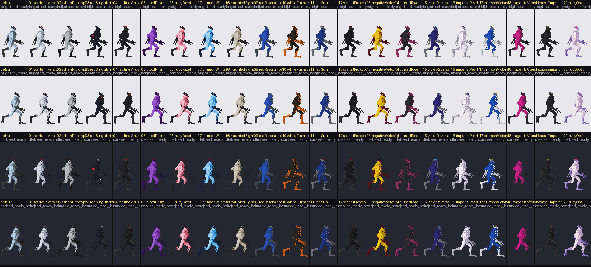

# Highbreed — Albedo theme regions

Albedo-only. Source: Albedo's own `__albedo` sheets (47 strips, base + alternate tables). Rules are first-match; unmatched pixels are kept. Each matched pixel takes its role's theme colour, ramped by its own brightness ÷ the rule's reference brightness (vref). Alpha is never changed.

Organic form.

| # | region | role | match | vref | pixels (all strips) |
|---|---|---|---|---|---|
| 0 | outline (kept) | keep | s 0–1, v 0–0.07 | 0 | 0 |
| 1 | pink detail | accent | h 280–45, s 0.25–1, v 0.1–1 | 0.937 | 87101 |
| 2 | white hide | primary | s 0–0.25, v 0.3–1 | 0.906 | 653573 |
| 3 | dark hide | secondary | s 0–0.25, v 0.07–0.3 | 0.29 | 327502 |

## Animation coverage (themed wherever the art exists)

| action | art |
|---|---|
| idle | own art |
| walk | own art |
| light | own art |
| heavy | own art |
| hurt | own art |
| knockdown | own art |

## Genuine gaps (recorded, not invented)

- No Ultimatrix green existed on Ben's Highbreed (the `__albedo` strips are identical copies), so there is no energy region.

