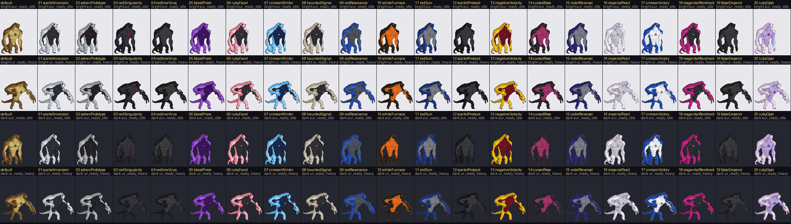

# Humongousaur — Albedo theme regions

Albedo-only. Source: Albedo's own `__albedo` sheets (37 strips, base + alternate tables). Rules are first-match; unmatched pixels are kept. Each matched pixel takes its role's theme colour, ramped by its own brightness ÷ the rule's reference brightness (vref). Alpha is never changed.

Organic form.

| # | region | role | match | vref | pixels (all strips) |
|---|---|---|---|---|---|
| 0 | outline (kept) | keep | s 0–1, v 0–0.07 | 0.059 | 4 |
| 1 | chest Ultimatrix | energy | h 356–4, s 0.74–0.86, v 0.04–1 | 0.58 | 933 |
| 2 | pale belly plates | secondary | h 38–100, s 0.15–1, v 0.07–1 | 0.804 | 160879 |
| 3 | tan hide | primary | h 0–37, s 0.15–1, v 0.07–1 | 0.553 | 220481 |

## Animation coverage (themed wherever the art exists)

| action | art |
|---|---|
| idle | own art |
| walk | own art |
| light | own art |
| heavy | own art |
| hurt | own art |
| knockdown | own art |

