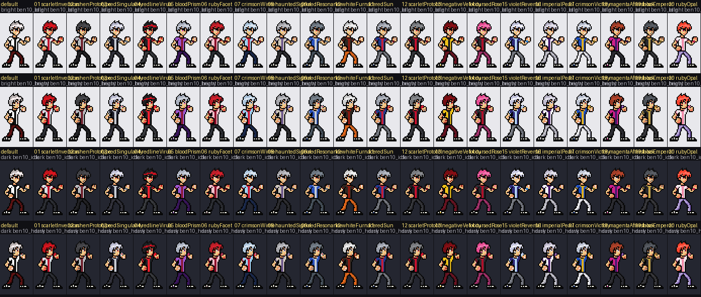

# Kid Albedo (Classic art) — Albedo theme regions

Albedo-only. Source: Albedo's own `__albedo` sheets (21 strips, base + alternate tables). Rules are first-match; unmatched pixels are kept. Each matched pixel takes its role's theme colour, ramped by its own brightness ÷ the rule's reference brightness (vref). Alpha is never changed.

| # | region | role | match | vref | pixels (all strips) |
|---|---|---|---|---|---|
| 0 | eyes / Ultimatrix light | energy | exact: `#b12323` `#7d1919` `#931d1d` | 0.694 | 263 |
| 1 | watch casing | accent | exact: `#454545` `#c0c0c0` | 0.753 | 70 |
| 2 | shirt panels | primary | exact: `#fcfcfd` `#f3f3f3` `#f2f2f7` | 0.992 | 4660 |
| 3 | shirt centre stripe | accent | exact: `#141414` | 0.078 | 1493 |
| 4 | pants | secondary | exact: `#631414` `#621414` `#3d0c0c` `#210707` `#350b0b` `#180808` | 0.388 | 3533 |
| 5 | hair | hair | exact: `#bcb4b4` `#fff5f5` `#e1d8d8` `#dad1d1` `#9b9494` `#beb7b7` | 1 | 2786 |

## Animation coverage (themed wherever the art exists)

| action | art |
|---|---|
| idle | own art |
| walk | own art |
| light | own art |
| heavy | own art |
| hurt | own art |
| knockdown | own art |

## Genuine gaps (recorded, not invented)

- Shoes are black + white soles shared with the outline / shirt whites: kept (no separate shoe region in the art).

