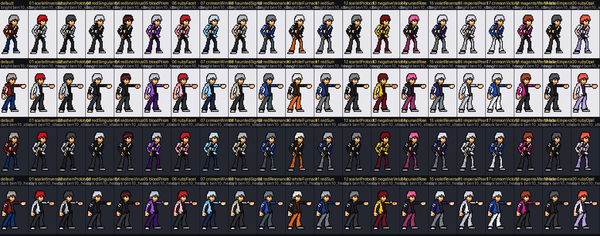

# Older Albedo (Alien Force art) — Albedo theme regions

Albedo-only. Source: Albedo's own `__albedo` sheets (21 strips, base + alternate tables). Rules are first-match; unmatched pixels are kept. Each matched pixel takes its role's theme colour, ramped by its own brightness ÷ the rule's reference brightness (vref). Alpha is never changed.

| # | region | role | match | vref | pixels (all strips) |
|---|---|---|---|---|---|
| 0 | eyes / Ultimatrix light | energy | exact: `#b12323` | 0.694 | 142 |
| 1 | jacket | primary | exact: `#931d1d` `#621414` `#350b0b` `#6a1515` | 0.576 | 4718 |
| 2 | jeans | secondary | exact: `#09367b` `#062553` `#004284` | 0.482 | 4287 |
| 3 | undershirt (darker) | secondary | exact: `#393939` `#1f1f1f` `#202020` `#141414` | 0.224 | 1445 |
| 4 | hair | hair | exact: `#9b9494` `#beb7b7` `#fff5f5` `#f9efef` | 0.745 | 2521 |
| 5 | skin / white trim / soles / outline | keep | exact: `#ffffff` `#e8e8e8` `#cecece` `#cec8ce` `#adadad` `#b0aab0` | 1 | 995 |

## Animation coverage (themed wherever the art exists)

| action | art |
|---|---|
| idle | own art |
| walk | own art |
| light | own art |
| heavy | own art |
| hurt | own art |
| knockdown | own art |

## Genuine gaps (recorded, not invented)

- No separate jacket trim / cuff colour in the art: the sleeve stripes are pure white `#ffffff`, the same entry as the eye whites and shoe soles, so they are KEPT white (a trim recolor would need new art to separate them). The accent role therefore has no region on the older sprite; the Ultimatrix watch shares the jacket reds and follows the primary.

