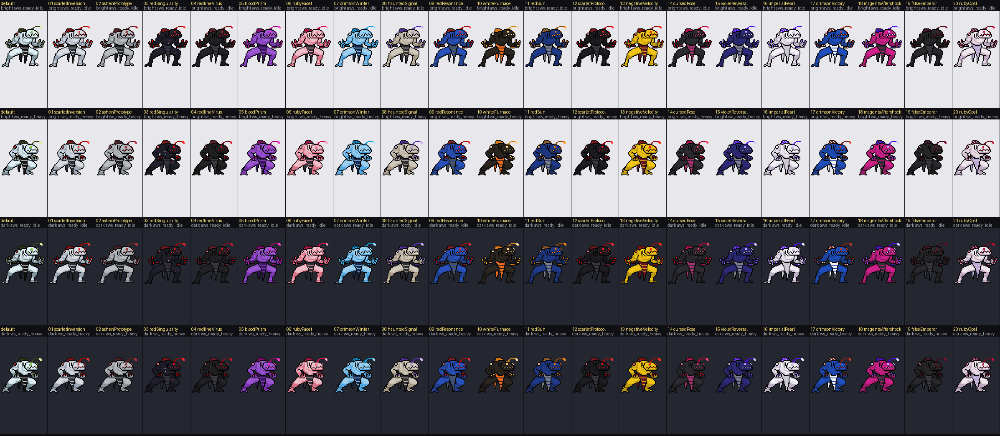

# Ripjaws — Albedo theme regions

Albedo-only. Source: Albedo's own `__albedo` sheets (45 strips, base + alternate tables). Rules are first-match; unmatched pixels are kept. Each matched pixel takes its role's theme colour, ramped by its own brightness ÷ the rule's reference brightness (vref). Alpha is never changed.

Organic form.

| # | region | role | match | vref | pixels (all strips) |
|---|---|---|---|---|---|
| 0 | outline (kept) | keep | s 0–1, v 0–0.07 | 0.031 | 47460 |
| 1 | Ultimatrix mark / lure glow | energy | h 356–4, s 0.74–0.86, v 0.04–1 | 0.902 | 216 |
| 2 | lure glow | energy | h 45–100, s 0.25–1, v 0.2–1 | 0.933 | 8306 |
| 3 | mouth / gills | accent | h 320–20, s 0.25–1, v 0.1–1 | 0.929 | 995 |
| 4 | grey-white hide | primary | s 0–0.25, v 0.5–1 | 0.973 | 71134 |
| 5 | dark hide | secondary | s 0–0.25, v 0.07–0.5 | 0.09 | 23676 |

## Animation coverage (themed wherever the art exists)

| action | art |
|---|---|
| idle | own art |
| walk | own art |
| light | own art |
| heavy | own art |
| hurt | own art |
| knockdown | own art |

