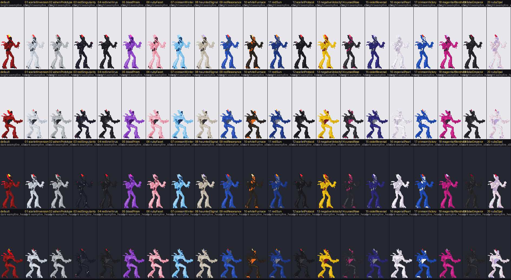

# Swampfire — Albedo theme regions

Albedo-only. Source: Albedo's own `__albedo` sheets (29 strips, base + alternate tables). Rules are first-match; unmatched pixels are kept. Each matched pixel takes its role's theme colour, ramped by its own brightness ÷ the rule's reference brightness (vref). Alpha is never changed.

Organic form.

| # | region | role | match | vref | pixels (all strips) |
|---|---|---|---|---|---|
| 0 | outline (kept) | keep | s 0–1, v 0–0.07 | 0 | 0 |
| 1 | seed / flame yellows | energy | h 20–70, s 0.25–1, v 0.3–1 | 0.973 | 11712 |
| 2 | Methanosian body (Ultimatrix red) | primary | h 356–4, s 0.74–0.86, v 0.04–1 | 0.596 | 122629 |
| 3 | body shading | primary | h 320–15, s 0.25–1, v 0.07–1 | 0.941 | 11250 |
| 4 | blue-grey body detail | secondary | h 180–260, s 0.15–1, v 0.07–1 | 0.157 | 17342 |

## Animation coverage (themed wherever the art exists)

| action | art |
|---|---|
| idle | own art |
| walk | own art |
| light | own art |
| heavy | own art |
| hurt | own art |
| knockdown | own art |

