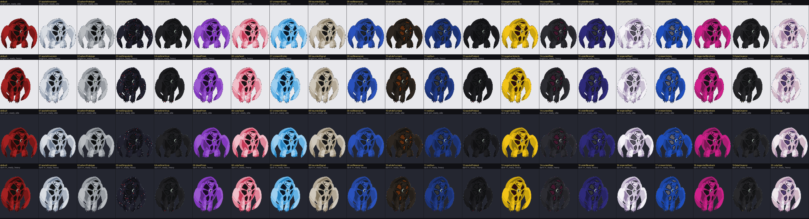

# Terraspin — Albedo theme regions

Albedo-only. Source: Albedo's own `__albedo` sheets (33 strips, base + alternate tables). Rules are first-match; unmatched pixels are kept. Each matched pixel takes its role's theme colour, ramped by its own brightness ÷ the rule's reference brightness (vref). Alpha is never changed.

Shell form.

| # | region | role | match | vref | pixels (all strips) |
|---|---|---|---|---|---|
| 0 | outline (kept) | keep | s 0–1, v 0–0.07 | 0.067 | 6664 |
| 1 | shell (Ultimatrix red) | primary | h 356–4, s 0.74–0.86, v 0.04–1 | 0.647 | 202422 |
| 2 | shell shading | primary | h 340–15, s 0.25–1, v 0.07–1 | 0 | 0 |
| 3 | green-grey underbody | secondary | h 60–140, s 0.2–1, v 0.07–1 | 0.663 | 14739 |
| 4 | tan / orange detail | accent | h 16–59, s 0.25–1, v 0.1–1 | 0.333 | 5084 |
| 5 | teal vents | energy | h 150–200, s 0.25–1, v 0.1–1 | 0.106 | 1 |

## Animation coverage (themed wherever the art exists)

| action | art |
|---|---|
| idle | own art |
| walk | own art |
| light | own art |
| heavy | own art |
| hurt | own art |
| knockdown | own art |

