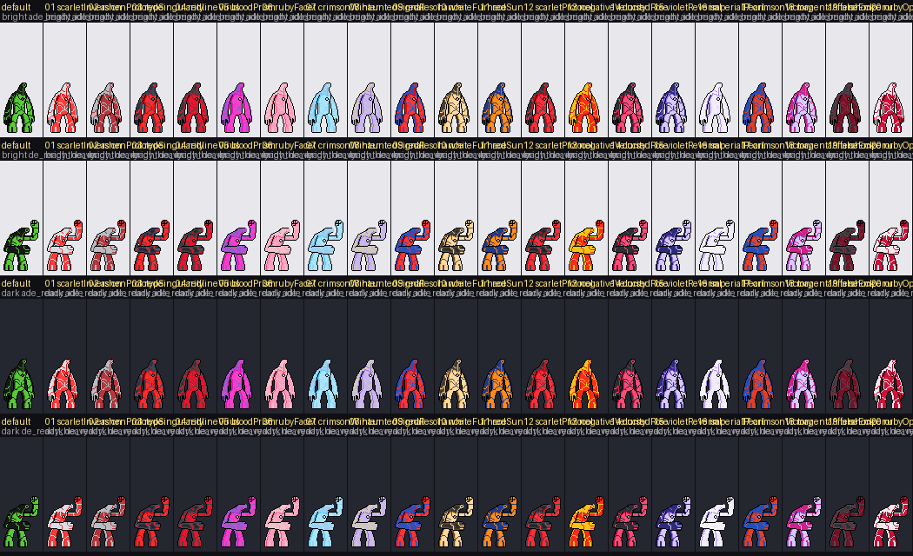

# Upgrade — Albedo theme regions

Albedo-only. Source: Albedo's own `__albedo` sheets (70 strips, base + alternate tables). Rules are first-match; unmatched pixels are kept. Each matched pixel takes its role's theme colour, ramped by its own brightness ÷ the rule's reference brightness (vref). Alpha is never changed.

Mechanical form: metal body (primary), plates (secondary), joints (accent) and circuit light (energy) stay distinct.

| # | region | role | match | vref | pixels (all strips) |
|---|---|---|---|---|---|
| 0 | outline (kept) | keep | s 0–1, v 0–0.07 | 0.031 | 49330 |
| 1 | circuit lines (green) + mark | energy | h 70–150, s 0.25–1, v 0.1–1 | 0.784 | 43772 |
| 2 | Ultimatrix mark | energy | h 356–4, s 0.74–0.86, v 0.04–1 | 0.902 | 360 |
| 3 | violet joints | accent | h 230–300, s 0.2–1, v 0.1–1 | 0.251 | 34 |
| 4 | black metal body | primary | s 0–0.25, v 0.07–0.5, inner rim | 0.09 | 71052 |
| 5 | white metal plates | secondary | s 0–0.25, v 0.5–1 | 0.953 | 43902 |

## Animation coverage (themed wherever the art exists)

| action | art |
|---|---|
| idle | own art |
| walk | own art |
| light | own art |
| heavy | own art |
| hurt | own art |
| knockdown | own art |

