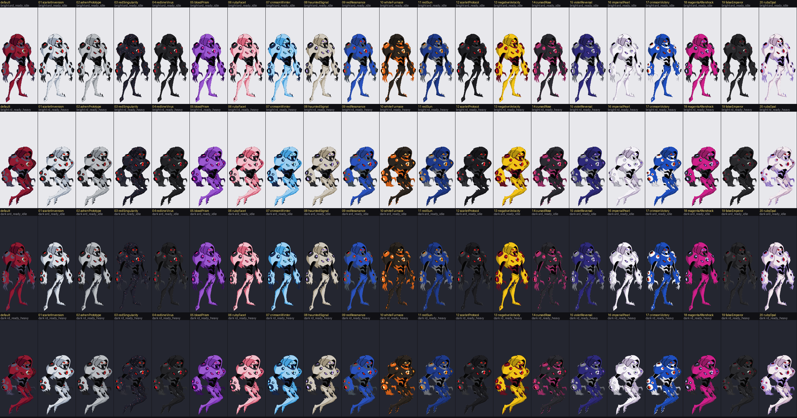

# Water Hazard — Albedo theme regions

Albedo-only. Source: Albedo's own `__albedo` sheets (39 strips, base + alternate tables). Rules are first-match; unmatched pixels are kept. Each matched pixel takes its role's theme colour, ramped by its own brightness ÷ the rule's reference brightness (vref). Alpha is never changed.

Armoured form: shell / plates / lenses separate.

| # | region | role | match | vref | pixels (all strips) |
|---|---|---|---|---|---|
| 0 | outline (kept) | keep | s 0–1, v 0–0.07 | 0.035 | 68727 |
| 1 | eye slits / ports / mark (Ultimatrix red) | energy | h 356–4, s 0.74–0.86, v 0.04–1 | 0.757 | 18260 |
| 2 | Hydro Burst water core (FX) | keep | h 140–165, s 0.6–1, v 0.6–1 | 0.902 | 1761 |
| 3 | crimson shell | primary | h 300–20, s 0.25–1, v 0.07–1 | 0.565 | 564651 |
| 4 | blue-grey plates | secondary | h 200–299, s 0.12–1, v 0.07–1 | 0.427 | 167178 |
| 5 | grey plates | secondary | s 0–0.25, v 0.2–0.8 | 0.682 | 5440 |

## Animation coverage (themed wherever the art exists)

| action | art |
|---|---|
| idle | own art |
| walk | own art |
| light | own art |
| heavy | own art |
| hurt | own art |
| knockdown | own art |

## Genuine gaps (recorded, not invented)

- Separate FX sheets (`*_fx_*`: beams, bursts, puffs) are not body strips and keep their colours — the same rule the original __albedo pass used, so they look the same for Ben and Albedo and never leak between owners.

