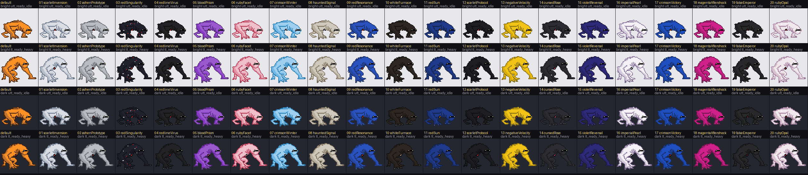

# Wildmutt — Albedo theme regions

Albedo-only. Source: Albedo's own `__albedo` sheets (37 strips, base + alternate tables). Rules are first-match; unmatched pixels are kept. Each matched pixel takes its role's theme colour, ramped by its own brightness ÷ the rule's reference brightness (vref). Alpha is never changed.

Fur form: fur shades (primary / secondary) are separate from the Ultimatrix mark / eyes (energy).

| # | region | role | match | vref | pixels (all strips) |
|---|---|---|---|---|---|
| 0 | outline (kept) | keep | s 0–1, v 0–0.07 | 0 | 2030 |
| 1 | flank Ultimatrix dot | energy | h 356–4, s 0.74–0.86, v 0.04–1 | 0.902 | 309 |
| 2 | sniff puff (FX) | keep | h 170–230, s 0.2–1, v 0.2–1 | 0.918 | 92 |
| 3 | red-orange fur shade / mouth | secondary | h 355–22, s 0.25–1, v 0.07–1 | 0.753 | 238 |
| 4 | orange fur | primary | h 22–60, s 0.25–1, v 0.07–1 | 0.988 | 84521 |

## Animation coverage (themed wherever the art exists)

| action | art |
|---|---|
| idle | own art |
| walk | own art |
| light | own art |
| heavy | own art |
| hurt | own art |
| knockdown | own art |

## Genuine gaps (recorded, not invented)

- Separate FX sheets (`*_fx_*`: beams, bursts, puffs) are not body strips and keep their colours — the same rule the original __albedo pass used, so they look the same for Ben and Albedo and never leak between owners.

