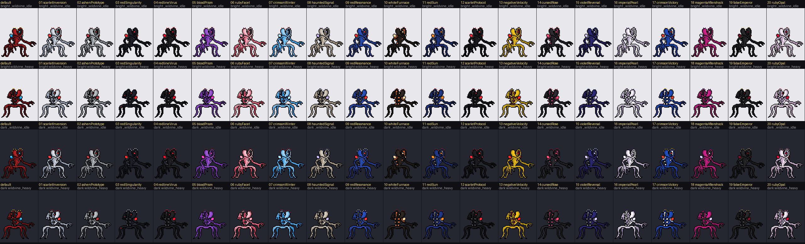

# Wildvine — Albedo theme regions

Albedo-only. Source: Albedo's own `__albedo` sheets (31 strips, base + alternate tables). Rules are first-match; unmatched pixels are kept. Each matched pixel takes its role's theme colour, ramped by its own brightness ÷ the rule's reference brightness (vref). Alpha is never changed.

Plant form.

| # | region | role | match | vref | pixels (all strips) |
|---|---|---|---|---|---|
| 0 | outline (kept) | keep | s 0–1, v 0–0.07 | 0 | 31124 |
| 1 | plant body (Ultimatrix red) | primary | h 356–4, s 0.74–0.86, v 0.04–1 | 0.694 | 32336 |
| 2 | body shading | primary | h 340–15, s 0.3–1, v 0.07–1 | 0 | 0 |
| 3 | blue eye-pods | energy | h 170–250, s 0.25–1, v 0.1–1 | 0.918 | 1308 |
| 4 | flower dots | accent | h 30–75, s 0.25–1, v 0.2–1 | 1 | 583 |
| 5 | dark vines | secondary | s 0–0.3, v 0.07–0.4 | 0.157 | 1543 |

## Animation coverage (themed wherever the art exists)

| action | art |
|---|---|
| idle | own art |
| walk | own art |
| light | own art |
| heavy | own art |
| hurt | own art |
| knockdown | own art |

