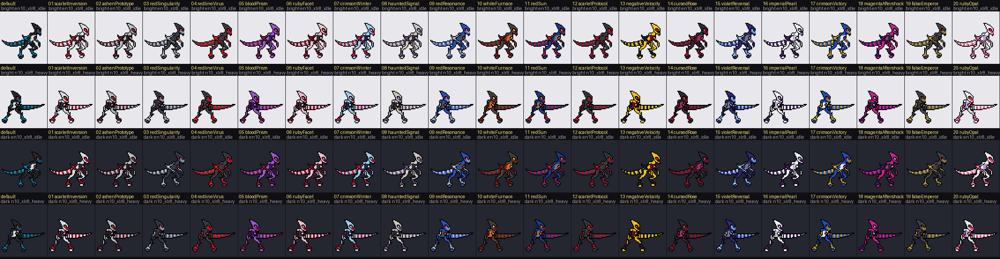

# XLR8 — Albedo theme regions

Albedo-only. Source: Albedo's own `__albedo` sheets (33 strips, base + alternate tables). Rules are first-match; unmatched pixels are kept. Each matched pixel takes its role's theme colour, ramped by its own brightness ÷ the rule's reference brightness (vref). Alpha is never changed.

Armoured form: shell / plates / lenses separate.

| # | region | role | match | vref | pixels (all strips) |
|---|---|---|---|---|---|
| 0 | outline (kept) | keep | s 0–1, v 0–0.07 | 0.031 | 24054 |
| 1 | Ultimatrix mark / visor highlight | energy | h 356–4, s 0.74–0.86, v 0.04–1 | 0.902 | 427 |
| 2 | blue stripes | accent | h 180–250, s 0.25–1, v 0.1–1 | 0.82 | 11575 |
| 3 | black armour | primary | s 0–0.25, v 0.07–0.45, inner rim | 0.161 | 15034 |
| 4 | visor / pale plates | secondary | s 0–0.25, v 0.45–1 | 0.918 | 1903 |

## Animation coverage (themed wherever the art exists)

| action | art |
|---|---|
| idle | own art |
| walk | own art |
| light | own art |
| heavy | own art |
| hurt | own art |
| knockdown | own art |

