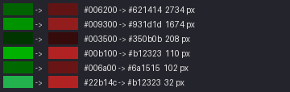
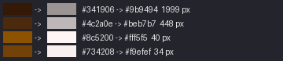
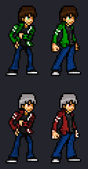
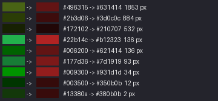
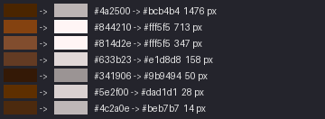

# Albedo — human variants palette

Generated by `tools/ben10/gen_albedo_ready.py` (deterministic). Engine: `tools/recolor_palette.py` (the same passes `tools/gen_albedo_recolor.py` always used for Albedo's human art).

- **GREEN → ALBEDO_RED**: hue 60–155°, saturation ≥ 0.35 → hue 0°, saturation 0.80, VALUE kept (one red per green shade, project-wide: the same function recolors every alien's Omnitrix green).
- **BROWN HAIR → GRAY** (owner choice 2026-11-18: keep Albedo's established gray hair): hue 12–45°, sat ≥ 0.5, value ≤ 0.6 → sat 0.04, value × 1.5 + 0.3. Skin (value 0.88–0.94, sat < 0.57) is excluded by the gates.
- Everything else (skin, black, white, denim / grey trousers, shoes) is untouched. Sizes / alpha / frame layout identical.

| variant | skin id (Albedo) | source sheet | runtime strips | reference |
|---|---|---|---|---|
| Alien Force | `default` | `assets/sprites/ben10/ben_alienforce.png` | `ben10_<action>_uniform__albedo.png` (characters.albedo) | `assets/sprites/ben10/albedo/human/alienforce.png` |
| Classic | `ben10Classic` | `assets/sprites/ben10/ben_classic.png` | `ben10_<action>_uniform__classic__albedo.png` | `assets/sprites/ben10/albedo/human/classic.png` |
| Prime (experimental) | `ben10Prime` | none — Prime renders the Alien Force frames | the Alien Force `__albedo` strips | `assets/sprites/ben10/albedo/human/prime.png` (= Alien Force recolored) |

## alienforce (21 strips + portrait)

Green regions found: 6 shades, 17.55 % of opaque pixels (the green jacket, its trim, the Omnitrix watch).

| source green | ALBEDO_RED | pixels |
|---|---|---|
| `#006200` | `#621414` | 2734 |
| `#009300` | `#931d1d` | 1674 |
| `#003500` | `#350b0b` | 208 |
| `#00b100` | `#b12323` | 110 |
| `#006a00` | `#6a1515` | 102 |
| `#22b14c` | `#b12323` | 32 |

Hair: 4 brown shades → gray.

| source | gray | pixels |
|---|---|---|
| `#341906` | `#9b9494` | 1999 |
| `#4c2a0e` | `#beb7b7` | 448 |
| `#8c5200` | `#fff5f5` | 40 |
| `#734208` | `#f9efef` | 34 |

## classic (21 strips + portrait)

Green regions found: 9 shades, 13.60 % of opaque pixels (the green cargo pants, the Omnitrix watch).

| source green | ALBEDO_RED | pixels |
|---|---|---|
| `#496315` | `#631414` | 1853 |
| `#2b3d06` | `#3d0c0c` | 884 |
| `#172102` | `#210707` | 532 |
| `#22b14c` | `#b12323` | 136 |
| `#006200` | `#621414` | 136 |
| `#177d36` | `#7d1919` | 93 |
| `#009300` | `#931d1d` | 34 |
| `#003500` | `#350b0b` | 12 |
| `#13380a` | `#380b0b` | 2 |

Hair: 7 brown shades → gray.

| source | gray | pixels |
|---|---|---|
| `#4a2500` | `#bcb4b4` | 1476 |
| `#844210` | `#fff5f5` | 713 |
| `#814d2e` | `#fff5f5` | 347 |
| `#633b23` | `#e1d8d8` | 158 |
| `#341906` | `#9b9494` | 50 |
| `#5e2f00` | `#dad1d1` | 28 |
| `#4c2a0e` | `#beb7b7` | 14 |

