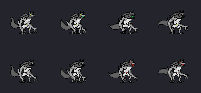

# benwolf — Albedo palette

Verdict: **recolored (Omnitrix eyes + mark)**  ·  generated by `tools/ben10/gen_albedo_ready.py` (deterministic)

Strips: 37 body strips (`*_uniform.png`, base + alternate tables) → `<strip>__albedo.png`; reference sheet `assets/sprites/ben10/albedo/aliens/benwolf.png` (= `ben10_benwolf_ready_idle_uniform.png` recolored). FX sheets (`*_fx_*`) unchanged.

Source palette: 11 distinct opaque colours. Remapped: 2 colours = 0.41 % of opaque pixels.

Rule (passes, `tools/recolor_palette.py`): `[{"from_": "b5e61d,22b14c", "tol": 0.0, "min_sat": 0.0, "to_hue": 0, "to_sat": 0.8}]`

## Remapped

#b5e61d eyes and #22b14c chest mark

## Deliberately left alone

the grey fur, white, black

## Source → ALBEDO_RED (top shades by pixel count)

| source | albedo | pixels |
|---|---|---|
| `#b5e61d` | `#e62e2e` | 180 |
| `#22b14c` | `#b12323` | 162 |

## Before / after (idle strip; top = Ben, bottom = Albedo)

