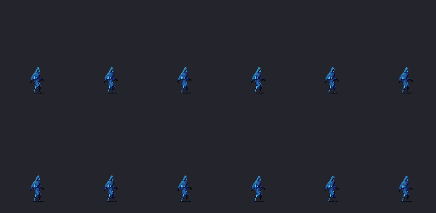

# bigchill — Albedo palette

Verdict: **recolored (Omnitrix mark only)**  ·  generated by `tools/ben10/gen_albedo_ready.py` (deterministic)

Strips: 40 body strips (`*_uniform.png`, base + alternate tables) → `<strip>__albedo.png`; reference sheet `assets/sprites/ben10/albedo/aliens/bigchill.png` (= `ben10_bigchill_ready_idle_uniform.png` recolored). FX sheets (`*_fx_*`) unchanged.

Source palette: 30 distinct opaque colours. Remapped: 1 colours = 0.10 % of opaque pixels.

Rule (passes, `tools/recolor_palette.py`): `[{"from_": "209800", "tol": 0.0, "min_sat": 0.0, "to_hue": 0, "to_sat": 0.8}]`

## Remapped

#209800 — the small Omnitrix mark

## Deliberately left alone

every blue / blue-green ice tone — a different hue and role, per the brief

## Source → ALBEDO_RED (top shades by pixel count)

| source | albedo | pixels |
|---|---|---|
| `#209800` | `#981e1e` | 446 |

## Before / after (idle strip; top = Ben, bottom = Albedo)

