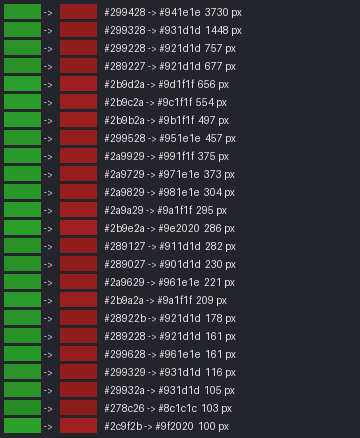
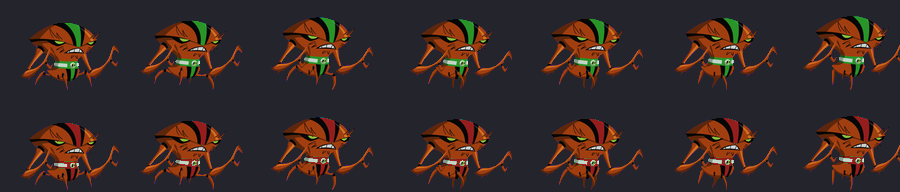

# brainstorm — Albedo palette

Verdict: **recolored (green stripes / collar / eyes)**  ·  generated by `tools/ben10/gen_albedo_ready.py` (deterministic)

Strips: 35 body strips (`*_uniform.png`, base + alternate tables) → `<strip>__albedo.png`; reference sheet `assets/sprites/ben10/albedo/aliens/brainstorm.png` (= `ben10_brainstorm_ready_idle_uniform.png` recolored). FX sheets (`*_fx_*`) unchanged.

Source palette: 33649 distinct opaque colours. Remapped: 3876 colours = 9.85 % of opaque pixels.

Rule (passes, `tools/recolor_palette.py`): `[{"from_hue": "90-150", "min_sat": 0.35, "min_val": 0.12, "to_hue": 0, "to_sat": 0.8}]`

## Remapped

every green h90–150 (resampled sheet: ~7.4k anti-aliased shades centred on #299428): head stripes, Omnitrix collar band, green eyes — a green-accented form named in the brief

## Deliberately left alone

#efe45c (h56) yellow; the orange-brown carapace; teeth / white

## Source → ALBEDO_RED (top shades by pixel count)

| source | albedo | pixels |
|---|---|---|
| `#299428` | `#941e1e` | 3730 |
| `#299328` | `#931d1d` | 1448 |
| `#299228` | `#921d1d` | 757 |
| `#289227` | `#921d1d` | 677 |
| `#2b9d2a` | `#9d1f1f` | 656 |
| `#2b9c2a` | `#9c1f1f` | 554 |
| `#2b9b2a` | `#9b1f1f` | 497 |
| `#299528` | `#951e1e` | 457 |
| `#2a9929` | `#991f1f` | 375 |
| `#2a9729` | `#971e1e` | 373 |
| `#2a9829` | `#981e1e` | 304 |
| `#2a9a29` | `#9a1f1f` | 295 |
| `#2b9e2a` | `#9e2020` | 286 |
| `#289127` | `#911d1d` | 282 |
| `#289027` | `#901d1d` | 230 |
| `#2a9629` | `#961e1e` | 221 |
| `#2b9a2a` | `#9a1f1f` | 209 |
| `#28922b` | `#921d1d` | 178 |
| `#289228` | `#921d1d` | 161 |
| `#299628` | `#961e1e` | 161 |
| `#299329` | `#931d1d` | 116 |
| `#29932a` | `#931d1d` | 105 |
| `#278c26` | `#8c1c1c` | 103 |
| `#2c9f2b` | `#9f2020` | 100 |

…and 3852 more anti-aliased shades (same rule).

## Before / after (idle strip; top = Ben, bottom = Albedo)

