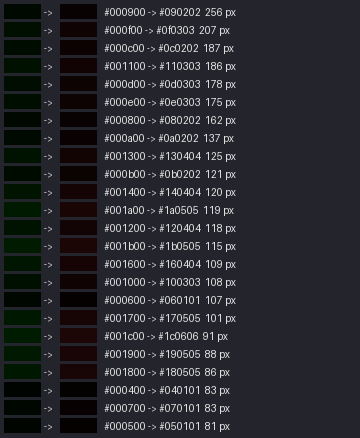
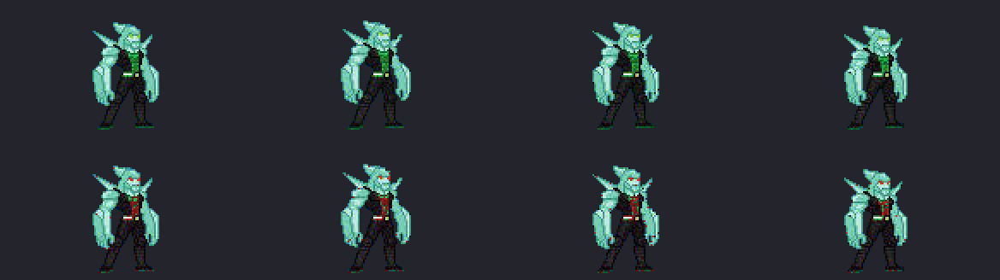

# diamondhead_ov — Albedo palette

Verdict: **recolored (green shirt + mark); crystal left**  ·  generated by `tools/ben10/gen_albedo_ready.py` (deterministic)

Strips: 64 body strips (`*_uniform.png`, base + alternate tables) → `<strip>__albedo.png`; reference sheet `assets/sprites/ben10/albedo/aliens/diamondhead_ov.png` (= `ben10_diamondhead_idle_uniform.png` recolored). FX sheets (`*_fx_*`) unchanged.

Source palette: 28037 distinct opaque colours. Remapped: 2287 colours = 8.15 % of opaque pixels.

Rule (passes, `tools/recolor_palette.py`): `[{"from_hue": "85-140", "min_sat": 0.5, "min_val": 0.0, "to_hue": 0, "to_sat": 0.8}]`

## Remapped

greens h85–140 (sat ≥ 0.5): his GREEN SHIRT panel (#002000…#002900 shadows, mid greens) and the Omnitrix — Ben's clothing green

## Deliberately left alone

the TEAL CRYSTAL body h150–172 (#79cead, #40988c, #b4f0d6 …) — a different hue and role (his crystal), kept as the brief requires; the alt-palette strips follow the same rule

## Source → ALBEDO_RED (top shades by pixel count)

| source | albedo | pixels |
|---|---|---|
| `#000900` | `#090202` | 256 |
| `#000f00` | `#0f0303` | 207 |
| `#000c00` | `#0c0202` | 187 |
| `#001100` | `#110303` | 186 |
| `#000d00` | `#0d0303` | 178 |
| `#000e00` | `#0e0303` | 175 |
| `#000800` | `#080202` | 162 |
| `#000a00` | `#0a0202` | 137 |
| `#001300` | `#130404` | 125 |
| `#000b00` | `#0b0202` | 121 |
| `#001400` | `#140404` | 120 |
| `#001a00` | `#1a0505` | 119 |
| `#001200` | `#120404` | 118 |
| `#001b00` | `#1b0505` | 115 |
| `#001600` | `#160404` | 109 |
| `#001000` | `#100303` | 108 |
| `#000600` | `#060101` | 107 |
| `#001700` | `#170505` | 101 |
| `#001c00` | `#1c0606` | 91 |
| `#001900` | `#190505` | 88 |
| `#001800` | `#180505` | 86 |
| `#000400` | `#040101` | 83 |
| `#000700` | `#070101` | 83 |
| `#000500` | `#050101` | 81 |

…and 2263 more anti-aliased shades (same rule).

## Before / after (idle strip; top = Ben, bottom = Albedo)

