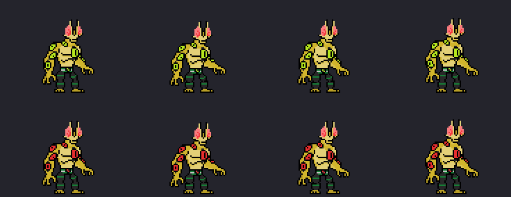

# eyeguy — Albedo palette

Verdict: **recolored (Omnitrix lime eyes); shorts AMBIGUOUS-left**  ·  generated by `tools/ben10/gen_albedo_ready.py` (deterministic)

Strips: 34 body strips (`*_uniform.png`, base + alternate tables) → `<strip>__albedo.png`; reference sheet `assets/sprites/ben10/albedo/aliens/eyeguy.png` (= `ben10_eyeguy_ready_idle_uniform.png` recolored). FX sheets (`*_fx_*`) unchanged.

Source palette: 15 distinct opaque colours. Remapped: 1 colours = 6.97 % of opaque pixels.

Rule (passes, `tools/recolor_palette.py`): `[{"from_": "b5e61d", "tol": 0.0, "min_sat": 0.0, "to_hue": 0, "to_sat": 0.8}]`

## Remapped

#b5e61d — every eye on his body + the in-strip Gaze orb are the exact Omnitrix lime

## Deliberately left alone

AMBIGUOUS — #177d36 / #1d9441 / #14692e / #0d481f (h138): his dark-green SHORTS. Same hue family as #22b14c but a clothing role, not the Omnitrix; left green rather than guessed. Separate eye-beam FX sheets (*_fx_*) keep their colours, so a live beam stays green while the in-strip orb is red

## Source → ALBEDO_RED (top shades by pixel count)

| source | albedo | pixels |
|---|---|---|
| `#b5e61d` | `#e62e2e` | 5048 |

## Before / after (idle strip; top = Ben, bottom = Albedo)

