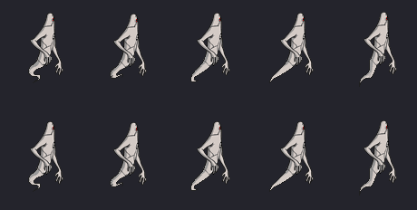

# ghostfreak — Albedo palette

Verdict: **recolored (Omnitrix timeout flash)**  ·  generated by `tools/ben10/gen_albedo_ready.py` (deterministic)

Strips: 36 body strips (`*_uniform.png`, base + alternate tables) → `<strip>__albedo.png`; reference sheet `assets/sprites/ben10/albedo/aliens/ghostfreak.png` (= `ben10_ghostfreak_idle_uniform.png` recolored). FX sheets (`*_fx_*`) unchanged.

Source palette: 32 distinct opaque colours. Remapped: 1 colours = 6.44 % of opaque pixels.

Rule (passes, `tools/recolor_palette.py`): `[{"from_": "66ff00", "tol": 0.0, "min_sat": 0.0, "to_hue": 0, "to_sat": 0.8}]`

## Remapped

#66ff00 — the whole-body Omnitrix green flash of his timeout strip (Omnitrix energy → Ultimatrix red)

## Deliberately left alone

#18201f (h172, v0.13) near-black outline; the grey ghost body; the red eye

## Source → ALBEDO_RED (top shades by pixel count)

| source | albedo | pixels |
|---|---|---|
| `#66ff00` | `#ff3333` | 6940 |

## Before / after (idle strip; top = Ben, bottom = Albedo)

