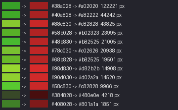
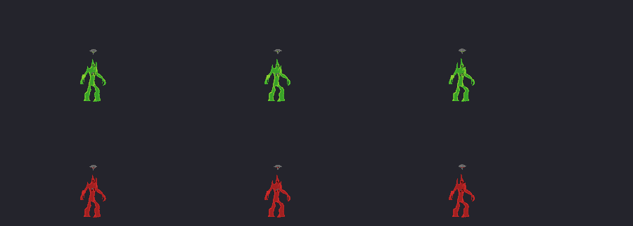

# goop — Albedo palette

Verdict: **recolored (green body)**  ·  generated by `tools/ben10/gen_albedo_ready.py` (deterministic)

Strips: 41 body strips (`*_uniform.png`, base + alternate tables) → `<strip>__albedo.png`; reference sheet `assets/sprites/ben10/albedo/aliens/goop.png` (= `ben10_goop_idle_uniform.png` recolored). FX sheets (`*_fx_*`) unchanged.

Source palette: 15 distinct opaque colours. Remapped: 12 colours = 95.67 % of opaque pixels.

Rule (passes, `tools/recolor_palette.py`): `[{"from_hue": "75-120", "min_sat": 0.3, "min_val": 0.0, "to_hue": 0, "to_sat": 0.8}]`

## Remapped

his whole green goo body (10 shades h83–112 + #384828 / #408028 shading) — a green-bodied form per the brief

## Deliberately left alone

the anti-gravity projector (grey / purple) and every non-green colour

## Source → ALBEDO_RED (top shades by pixel count)

| source | albedo | pixels |
|---|---|---|
| `#38a028` | `#a02020` | 122221 |
| `#40a828` | `#a82222` | 44242 |
| `#88c830` | `#c82828` | 43825 |
| `#58b028` | `#b02323` | 23995 |
| `#48b830` | `#b82525` | 21005 |
| `#78c030` | `#c02626` | 20938 |
| `#68b828` | `#b82525` | 19501 |
| `#98d830` | `#d82b2b` | 14908 |
| `#90d030` | `#d02a2a` | 14520 |
| `#58c830` | `#c82828` | 9966 |
| `#384828` | `#480e0e` | 4218 |
| `#408028` | `#801a1a` | 1851 |

## Before / after (idle strip; top = Ben, bottom = Albedo)

