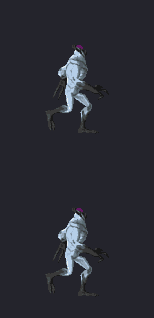

# highbreed — Albedo palette

Verdict: **NO GREEN FOUND (identical art, registered)**  ·  generated by `tools/ben10/gen_albedo_ready.py` (deterministic)

Strips: 47 body strips (`*_uniform.png`, base + alternate tables) → `<strip>__albedo.png`; reference sheet `assets/sprites/ben10/albedo/aliens/highbreed.png` (= `ben10_highbreed_ready_idle_uniform.png` recolored). FX sheets (`*_fx_*`) unchanged.

Source palette: 15 distinct opaque colours. Remapped: 0 colours = 0.00 % of opaque pixels.

Rule (passes, `tools/recolor_palette.py`): `[]`

## Remapped

none — the sheet has no green-family colour at all (15 colours, checked)

## Deliberately left alone

everything (white / grey / black / pink) — the Albedo strips are byte-identical copies, registered explicitly so nothing falls back to Ben's file

## Source → ALBEDO_RED (top shades by pixel count)

None (no green found — identical art).

## Before / after (idle strip; top = Ben, bottom = Albedo)

