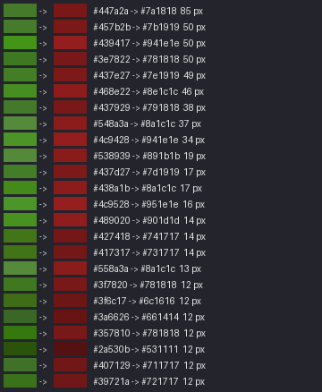
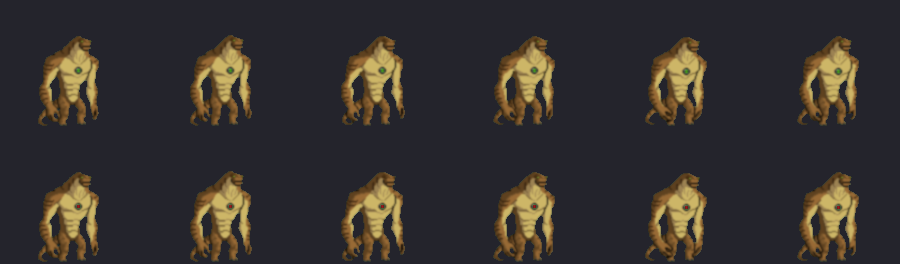

# humongousaur — Albedo palette

Verdict: **recolored (Omnitrix mark only)**  ·  generated by `tools/ben10/gen_albedo_ready.py` (deterministic)

Strips: 37 body strips (`*_uniform.png`, base + alternate tables) → `<strip>__albedo.png`; reference sheet `assets/sprites/ben10/albedo/aliens/humongousaur.png` (= `ben10_humongousaur_ready_idle_uniform.png` recolored). FX sheets (`*_fx_*`) unchanged.

Source palette: 20881 distinct opaque colours. Remapped: 126 colours = 0.24 % of opaque pixels.

Rule (passes, `tools/recolor_palette.py`): `[{"from_hue": "85-130", "min_sat": 0.5, "min_val": 0.2, "to_hue": 0, "to_sat": 0.8}]`

## Remapped

#447a2a and its anti-aliased shades — the chest Omnitrix

## Deliberately left alone

the olive-grey body shading #393b2d … #868c60 (h57–88, sat 0.21–0.31) — brown skin shading, not green

## Source → ALBEDO_RED (top shades by pixel count)

| source | albedo | pixels |
|---|---|---|
| `#447a2a` | `#7a1818` | 85 |
| `#457b2b` | `#7b1919` | 50 |
| `#439417` | `#941e1e` | 50 |
| `#3e7822` | `#781818` | 50 |
| `#437e27` | `#7e1919` | 49 |
| `#468e22` | `#8e1c1c` | 46 |
| `#437929` | `#791818` | 38 |
| `#548a3a` | `#8a1c1c` | 37 |
| `#4c9428` | `#941e1e` | 34 |
| `#538939` | `#891b1b` | 19 |
| `#437d27` | `#7d1919` | 17 |
| `#438a1b` | `#8a1c1c` | 17 |
| `#4c9528` | `#951e1e` | 16 |
| `#489020` | `#901d1d` | 14 |
| `#427418` | `#741717` | 14 |
| `#417317` | `#731717` | 14 |
| `#558a3a` | `#8a1c1c` | 13 |
| `#3f7820` | `#781818` | 12 |
| `#3f6c17` | `#6c1616` | 12 |
| `#3a6626` | `#661414` | 12 |
| `#357810` | `#781818` | 12 |
| `#2a530b` | `#531111` | 12 |
| `#407129` | `#711717` | 12 |
| `#39721a` | `#721717` | 12 |

…and 102 more anti-aliased shades (same rule).

## Before / after (idle strip; top = Ben, bottom = Albedo)

