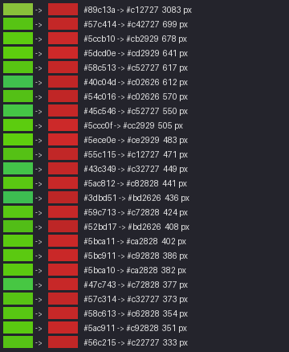
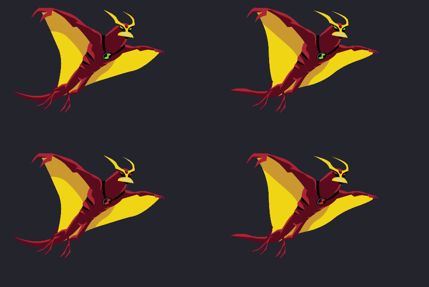

# jetray — Albedo palette

Verdict: **recolored (Omnitrix mark + green eyes)**  ·  generated by `tools/ben10/gen_albedo_ready.py` (deterministic)

Strips: 36 body strips (`*_uniform.png`, base + alternate tables) → `<strip>__albedo.png`; reference sheet `assets/sprites/ben10/albedo/aliens/jetray.png` (= `ben10_jetray_ready_idle_uniform.png` recolored). FX sheets (`*_fx_*`) unchanged.

Source palette: 5914 distinct opaque colours. Remapped: 1808 colours = 3.08 % of opaque pixels.

Rule (passes, `tools/recolor_palette.py`): `[{"from_hue": "80-135", "min_sat": 0.5, "min_val": 0.3, "to_hue": 0, "to_sat": 0.8}]`

## Remapped

greens h80–135 (resampled): the chest Omnitrix + green eye highlights

## Deliberately left alone

#b3b34c (h60) and the yellow wing membrane, the crimson body — not green

## Source → ALBEDO_RED (top shades by pixel count)

| source | albedo | pixels |
|---|---|---|
| `#89c13a` | `#c12727` | 3083 |
| `#57c414` | `#c42727` | 699 |
| `#5ccb10` | `#cb2929` | 678 |
| `#5dcd0e` | `#cd2929` | 641 |
| `#58c513` | `#c52727` | 617 |
| `#40c04d` | `#c02626` | 612 |
| `#54c016` | `#c02626` | 570 |
| `#45c546` | `#c52727` | 550 |
| `#5ccc0f` | `#cc2929` | 505 |
| `#5ece0e` | `#ce2929` | 483 |
| `#55c115` | `#c12727` | 471 |
| `#43c349` | `#c32727` | 449 |
| `#5ac812` | `#c82828` | 441 |
| `#3dbd51` | `#bd2626` | 436 |
| `#59c713` | `#c72828` | 424 |
| `#52bd17` | `#bd2626` | 408 |
| `#5bca11` | `#ca2828` | 402 |
| `#5bc911` | `#c92828` | 386 |
| `#5bca10` | `#ca2828` | 382 |
| `#47c743` | `#c72828` | 377 |
| `#57c314` | `#c32727` | 373 |
| `#58c613` | `#c62828` | 354 |
| `#5ac911` | `#c92828` | 351 |
| `#56c215` | `#c22727` | 333 |

…and 1784 more anti-aliased shades (same rule).

## Before / after (idle strip; top = Ben, bottom = Albedo)

