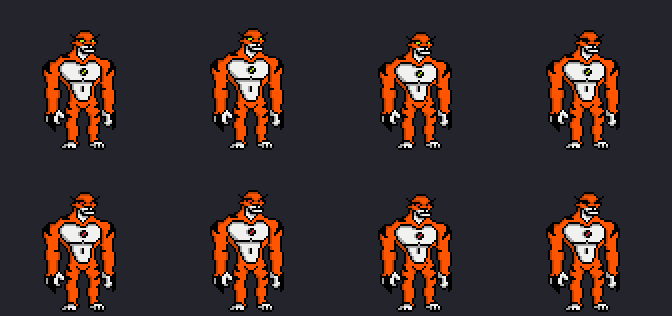

# rath — Albedo palette

Verdict: **recolored (Omnitrix chest mark)**  ·  generated by `tools/ben10/gen_albedo_ready.py` (deterministic)

Strips: 40 body strips (`*_uniform.png`, base + alternate tables) → `<strip>__albedo.png`; reference sheet `assets/sprites/ben10/albedo/aliens/rath.png` (= `ben10_rath_ready_idle_uniform.png` recolored). FX sheets (`*_fx_*`) unchanged.

Source palette: 29 distinct opaque colours. Remapped: 5 colours = 0.94 % of opaque pixels.

Rule (passes, `tools/recolor_palette.py`): `[{"from_": "b5e61d,22b14c,009300,006200,003500", "tol": 0.0, "min_sat": 0.0, "to_hue": 0, "to_sat": 0.8}]`

## Remapped

#009300 / #006200 / #003500 + #b5e61d / #22b14c — the chest Omnitrix cross and its shading

## Deliberately left alone

the orange / white tiger body, black stripes

## Source → ALBEDO_RED (top shades by pixel count)

| source | albedo | pixels |
|---|---|---|
| `#009300` | `#931d1d` | 616 |
| `#b5e61d` | `#e62e2e` | 285 |
| `#006200` | `#621414` | 49 |
| `#003500` | `#350b0b` | 4 |
| `#22b14c` | `#b12323` | 1 |

## Before / after (idle strip; top = Ben, bottom = Albedo)

