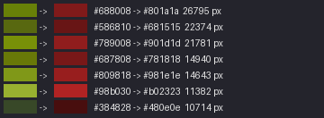
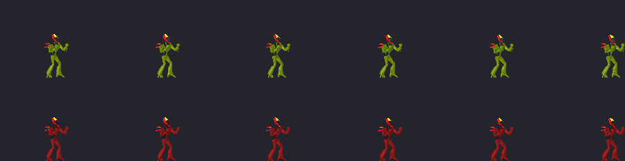

# swampfire — Albedo palette

Verdict: **recolored (green body)**  ·  generated by `tools/ben10/gen_albedo_ready.py` (deterministic)

Strips: 29 body strips (`*_uniform.png`, base + alternate tables) → `<strip>__albedo.png`; reference sheet `assets/sprites/ben10/albedo/aliens/swampfire.png` (= `ben10_swampfire_idle_uniform.png` recolored). FX sheets (`*_fx_*`) unchanged.

Source palette: 14 distinct opaque colours. Remapped: 7 colours = 74.03 % of opaque pixels.

Rule (passes, `tools/recolor_palette.py`): `[{"from_hue": "60-100", "min_sat": 0.3, "min_val": 0.0, "to_hue": 0, "to_sat": 0.8}]`

## Remapped

his olive-green Methanosian body (6 olive shades h69–72 + the dark green-grey outline #384828) — a green-bodied form, recolored like Ben's own green per the brief

## Deliberately left alone

#f8f030 (h58) the yellow seed/spots — yellow, not green; red/orange flame accents

## Source → ALBEDO_RED (top shades by pixel count)

| source | albedo | pixels |
|---|---|---|
| `#688008` | `#801a1a` | 26795 |
| `#586810` | `#681515` | 22374 |
| `#789008` | `#901d1d` | 21781 |
| `#687808` | `#781818` | 14940 |
| `#809818` | `#981e1e` | 14643 |
| `#98b030` | `#b02323` | 11382 |
| `#384828` | `#480e0e` | 10714 |

## Before / after (idle strip; top = Ben, bottom = Albedo)

