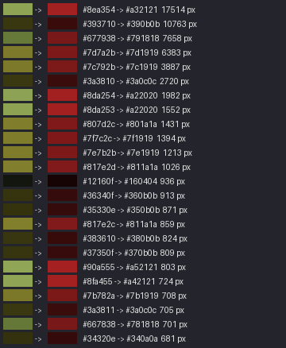
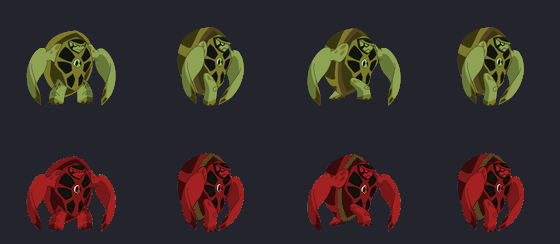

# terraspin — Albedo palette

Verdict: **recolored (green-olive shell body)**  ·  generated by `tools/ben10/gen_albedo_ready.py` (deterministic)

Strips: 33 body strips (`*_uniform.png`, base + alternate tables) → `<strip>__albedo.png`; reference sheet `assets/sprites/ben10/albedo/aliens/terraspin.png` (= `ben10_terraspin_ready_idle_uniform.png` recolored). FX sheets (`*_fx_*`) unchanged.

Source palette: 17715 distinct opaque colours. Remapped: 13917 colours = 81.45 % of opaque pixels.

Rule (passes, `tools/recolor_palette.py`): `[{"from_hue": "50-110", "min_sat": 0.3, "min_val": 0.0, "to_hue": 0, "to_sat": 0.8}]`

## Remapped

the olive-green shell and body (h57–77, ~14k anti-aliased shades) — a green-bodied form named in the brief

## Deliberately left alone

greys, blacks, the low-saturation (< 0.30) browns / greys

## Source → ALBEDO_RED (top shades by pixel count)

| source | albedo | pixels |
|---|---|---|
| `#8ea354` | `#a32121` | 17514 |
| `#393710` | `#390b0b` | 10763 |
| `#677938` | `#791818` | 7658 |
| `#7d7a2b` | `#7d1919` | 6383 |
| `#7c792b` | `#7c1919` | 3887 |
| `#3a3810` | `#3a0c0c` | 2720 |
| `#8da254` | `#a22020` | 1982 |
| `#8da253` | `#a22020` | 1552 |
| `#807d2c` | `#801a1a` | 1431 |
| `#7f7c2c` | `#7f1919` | 1394 |
| `#7e7b2b` | `#7e1919` | 1213 |
| `#817e2d` | `#811a1a` | 1026 |
| `#12160f` | `#160404` | 936 |
| `#36340f` | `#360b0b` | 913 |
| `#35330e` | `#350b0b` | 871 |
| `#817e2c` | `#811a1a` | 859 |
| `#383610` | `#380b0b` | 824 |
| `#37350f` | `#370b0b` | 809 |
| `#90a555` | `#a52121` | 803 |
| `#8fa455` | `#a42121` | 724 |
| `#7b782a` | `#7b1919` | 708 |
| `#3a3811` | `#3a0c0c` | 705 |
| `#667838` | `#781818` | 701 |
| `#34320e` | `#340a0a` | 681 |

…and 13893 more anti-aliased shades (same rule).

## Before / after (idle strip; top = Ben, bottom = Albedo)

