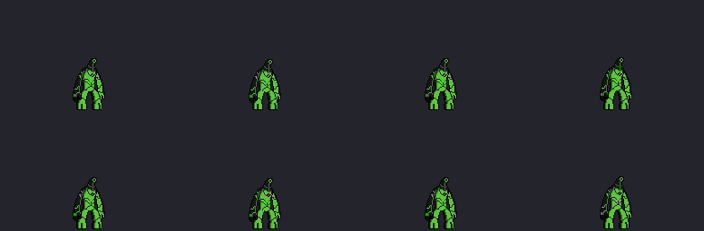

# upgrade_ov — Albedo palette

Verdict: **recolored (Omnitrix mark); body AMBIGUOUS-left**  ·  generated by `tools/ben10/gen_albedo_ready.py` (deterministic)

Strips: 70 body strips (`*_uniform.png`, base + alternate tables) → `<strip>__albedo.png`; reference sheet `assets/sprites/ben10/albedo/aliens/upgrade_ov.png` (= `ben10_upgrade_ready_idle_uniform.png` recolored). FX sheets (`*_fx_*`) unchanged.

Source palette: 63 distinct opaque colours. Remapped: 1 colours = 0.17 % of opaque pixels.

Rule (passes, `tools/recolor_palette.py`): `[{"from_": "b5e61d", "tol": 0.0, "min_sat": 0.0, "to_hue": 0, "to_sat": 0.8}]`

## Remapped

#b5e61d — the Omnitrix mark

## Deliberately left alone

AMBIGUOUS — #58c837 / #398226 (h106) and their ~50 shades: his green circuit-body. Not one of the brief's named green-bodied forms and a different hue (h106 vs the lime h75); left green rather than guessed

## Source → ALBEDO_RED (top shades by pixel count)

| source | albedo | pixels |
|---|---|---|
| `#b5e61d` | `#e62e2e` | 360 |

## Before / after (idle strip; top = Ben, bottom = Albedo)

