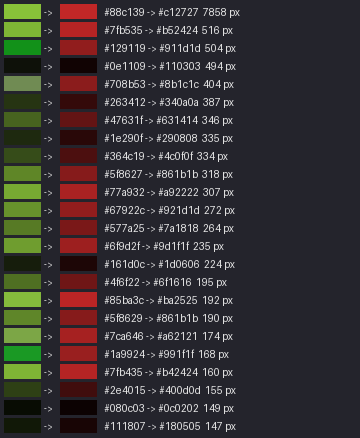
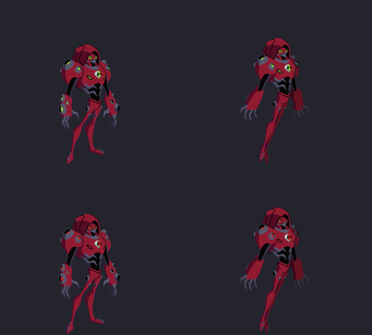

# waterhazard — Albedo palette

Verdict: **recolored (Omnitrix + green eye/port lenses)**  ·  generated by `tools/ben10/gen_albedo_ready.py` (deterministic)

Strips: 39 body strips (`*_uniform.png`, base + alternate tables) → `<strip>__albedo.png`; reference sheet `assets/sprites/ben10/albedo/aliens/waterhazard.png` (= `ben10_waterhazard_ready_idle_uniform.png` recolored). FX sheets (`*_fx_*`) unchanged.

Source palette: 3706 distinct opaque colours. Remapped: 280 colours = 2.20 % of opaque pixels.

Rule (passes, `tools/recolor_palette.py`): `[{"from_hue": "80-130", "min_sat": 0.35, "min_val": 0.0, "to_hue": 0, "to_sat": 0.8}]`

## Remapped

greens h80–130 (resampled, centred on #88c139): the eye slits, the green port lenses and the chest Omnitrix

## Deliberately left alone

#00e666 (h147) — the Hydro Burst water-core inside its strip (FX); the crimson armour, greys

## Source → ALBEDO_RED (top shades by pixel count)

| source | albedo | pixels |
|---|---|---|
| `#88c139` | `#c12727` | 7858 |
| `#7fb535` | `#b52424` | 516 |
| `#129119` | `#911d1d` | 504 |
| `#0e1109` | `#110303` | 494 |
| `#708b53` | `#8b1c1c` | 404 |
| `#263412` | `#340a0a` | 387 |
| `#47631f` | `#631414` | 346 |
| `#1e290f` | `#290808` | 335 |
| `#364c19` | `#4c0f0f` | 334 |
| `#5f8627` | `#861b1b` | 318 |
| `#77a932` | `#a92222` | 307 |
| `#67922c` | `#921d1d` | 272 |
| `#577a25` | `#7a1818` | 264 |
| `#6f9d2f` | `#9d1f1f` | 235 |
| `#161d0c` | `#1d0606` | 224 |
| `#4f6f22` | `#6f1616` | 195 |
| `#85ba3c` | `#ba2525` | 192 |
| `#5f8629` | `#861b1b` | 190 |
| `#7ca646` | `#a62121` | 174 |
| `#1a9924` | `#991f1f` | 168 |
| `#7fb435` | `#b42424` | 160 |
| `#2e4015` | `#400d0d` | 155 |
| `#080c03` | `#0c0202` | 149 |
| `#111807` | `#180505` | 147 |

…and 256 more anti-aliased shades (same rule).

## Before / after (idle strip; top = Ben, bottom = Albedo)

