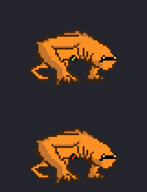

# wildmutt_ov — Albedo palette

Verdict: **recolored (flank Omnitrix dot)**  ·  generated by `tools/ben10/gen_albedo_ready.py` (deterministic)

Strips: 37 body strips (`*_uniform.png`, base + alternate tables) → `<strip>__albedo.png`; reference sheet `assets/sprites/ben10/albedo/aliens/wildmutt_ov.png` (= `ben10_wildmutt_ready_idle_uniform.png` recolored). FX sheets (`*_fx_*`) unchanged.

Source palette: 14 distinct opaque colours. Remapped: 3 colours = 0.35 % of opaque pixels.

Rule (passes, `tools/recolor_palette.py`): `[{"from_": "b5e61d,d0df50,408000", "tol": 0.0, "min_sat": 0.0, "to_hue": 0, "to_sat": 0.8}]`

## Remapped

#d0df50 / #b5e61d / #408000 — the flank Omnitrix dot (its grey ring stays grey)

## Deliberately left alone

#fdffc0 the pale highlight (not the dot); the orange fur, red mouth, blue sniff puff

## Source → ALBEDO_RED (top shades by pixel count)

| source | albedo | pixels |
|---|---|---|
| `#d0df50` | `#df2d2d` | 212 |
| `#b5e61d` | `#e62e2e` | 93 |
| `#408000` | `#801a1a` | 4 |

## Before / after (idle strip; top = Ben, bottom = Albedo)

