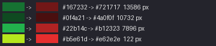
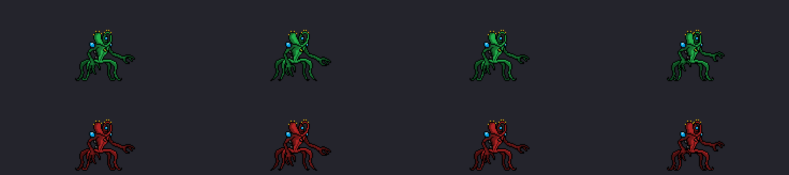

# wildvine — Albedo palette

Verdict: **recolored (green body + mark)**  ·  generated by `tools/ben10/gen_albedo_ready.py` (deterministic)

Strips: 31 body strips (`*_uniform.png`, base + alternate tables) → `<strip>__albedo.png`; reference sheet `assets/sprites/ben10/albedo/aliens/wildvine.png` (= `ben10_wildvine_idle_uniform.png` recolored). FX sheets (`*_fx_*`) unchanged.

Source palette: 11 distinct opaque colours. Remapped: 4 colours = 48.23 % of opaque pixels.

Rule (passes, `tools/recolor_palette.py`): `[{"from_hue": "130-145", "min_sat": 0.5, "min_val": 0.0, "to_hue": 0, "to_sat": 0.8}, {"from_": "b5e61d", "tol": 0.0, "min_sat": 0.0, "to_hue": 0, "to_sat": 0.8}]`

## Remapped

#22b14c / #167232 / #0f4a21 (h138) his plant body + #b5e61d mark

## Deliberately left alone

the blue eye-pods, yellow flower dots, black

## Source → ALBEDO_RED (top shades by pixel count)

| source | albedo | pixels |
|---|---|---|
| `#167232` | `#721717` | 13586 |
| `#0f4a21` | `#4a0f0f` | 10732 |
| `#22b14c` | `#b12323` | 7896 |
| `#b5e61d` | `#e62e2e` | 122 |

## Before / after (idle strip; top = Ben, bottom = Albedo)

