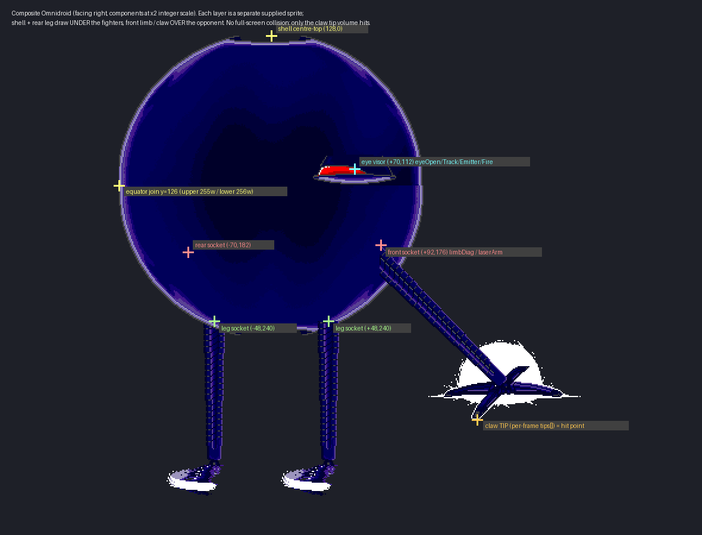
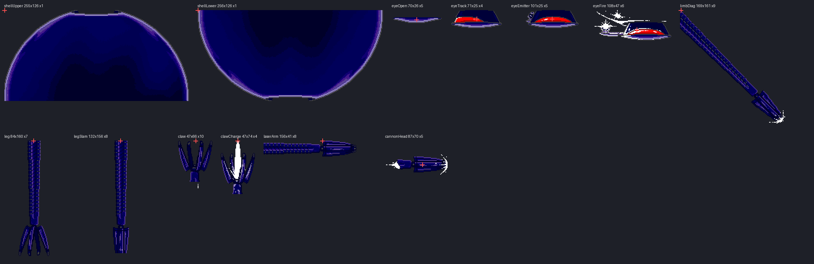

# Syndrome — the composite Omnidroid

The supplied "Omnidroid 10" sheet is a **component kit** (shell halves, eye states, diagonal limb, vertical legs, claws,
laser arm, cannon head, effects), not a pre-assembled robot. `syndromeFx.js` assembles it at runtime from those
components only — no new art, no stretching, integer ×2 nearest-neighbour scale, horizontal mirror for facing.

Every component strip, frame 0, with its origin (red cross): 

## Shell-local coordinates (1× component px, facing right)

| Anchor | Value | Notes |
|---|---|---|
| Upper dome `shellUpper` | top-left (0, 0), 255×126 | flat equator at y = 126 |
| Lower hemisphere `shellLower` | top-left (0, 126), 256×126 | the two halves are the same side view; equator widths 255 / 256 measured → joined on the equator |
| Eye visor | (128 + 70·dir, 112) | `eyeOpen` (5) / `eyeTrack` (4) / `eyeEmitter` (5) / `eyeFire` (6) |
| Front limb socket | (128 + 92·dir, 176) | `limbDiag` (9) and `laserArm` (8) attach here |
| Rear limb socket | (128 − 70·dir, 182) | |
| Leg sockets | (128 ± 48, 240) | `leg` (7) / `legSlam` (8) |
| Claw tip | per-frame `tips[]` of the limb strip | recorded by the extractor; THE hit point |

`OMNI` in `syndromeFx.js` holds these numbers. `shellAt(ax, ay, dir)` places the shell so its front socket lands on a
world point; `omniStrike()` takes a desired claw-tip world point and back-solves the socket (tip − tipOffset), so the
claw always lands exactly where the hit volume is.

## Layering

| Pass (game.js) | What | Why |
|---|---|---|
| `drawSyndromeUnder` (world space, before the fighters) | shell, rear leg, eye, floor warning markers, turret base, ultimate shell + planted legs | the giant body stands **behind** the arena action |
| fighters | Syndrome and the opponent | |
| `drawSyndromeOver` (after the fighters + munitions) | diagonal limb + claw, rising claw, leg drop, Spinner, Drones, Velocipod, shots, Zero-Point tether, grab claw, ultimate claws | the striking claw reads **in front of** the opponent it hits |
| HUD | slot readout, Operation Kronos cut-in | screen space |

## Collision

**No full-screen collision.** The Omnidroid body never collides or hurts. Each Omnidroid action spawns exactly one engine
projectile volume at the claw tip / foot / arm (Hammerfall 156×90 at the slam point, Rising Interception 70×190, Sweep
120×44 moving along the floor, Claw Drive / Rising Claw / Leg Drop = the move's own box), each connecting once. Volumes
use the shared guard, blockstun, combo scaling and juggle rules.

## Actions built from the kit

| Action | Components | Timing |
|---|---|---|
| Claw Drive (Heavy) | shell slides in from above, `limbDiag` 0–1 reach, 2–5 drive (active), 6–8 retract | 14 f startup |
| Rising Claw (launcher) | `claw` frames over shaft tiles cut from `leg` frame 1 (pixels reused, clipped at the floor) | 12 f |
| Leg Drop (air Heavy) | `legSlam` descending under Syndrome | 12 f |
| Grab | `leg` frame 0 claw holds the grabbed opponent, lifts with the throw | shared grab |
| Hammerfall | floor marker (40 f) → shell + limb wind-up → `limbDiag` slam → retract | 40 f warning |
| Rising Interception | marker → `clawCharge` rising out of the floor | 26 f warning |
| Sweep | marker → limb drags `limbDiag` 6–7 along the floor | 18 f warning |
| Ultimate | rising shell + eye states, planted legs, two limb assemblies (lift from below + `legSlam` pin from above), slam | see MOVESET.md |

Previews (in-game captures from `harness/syndrome_visual.mjs`): Claw Drive `visual_09_R_claw_drive.png`, Hammerfall
warning / slam `visual_14_R_hammerfall_warn.png` / `visual_14b_R_hammerfall_slam.png`, Sweep `visual_15_R_sweep.png`,
Rising Interception `visual_16_R_rising_interception.png`, ultimate stages `visual_21_R_ult_*.png`, mirror match with two
arsenals `visual_22_mirror_two_arsenals.png`.

Regenerate the diagrams: `python3 tools/syndrome/assembly_diagram.py`.
